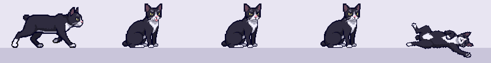
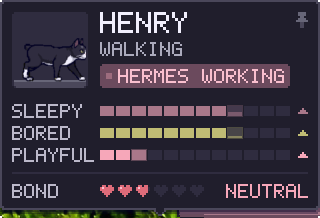

<div align="center">

# Henry

**A pixel-art cat that lives on your Windows desktop.**

She walks along your taskbar and window tops, naps in her little bed, comes over to be petted,<br>
and, if you use [Hermes Agent](https://github.com/NousResearch/hermes-agent), keeps an eye on what your agent is doing.



[](https://github.com/exaar/henry_pet/releases/latest)


[](LICENSE)

</div>

## What she does

- **Lives on your screen, not in a window.** Walks the taskbar, hops onto window tops, rides along when you drag a window, and gets down again. Crosses between monitors.
- **Has a life of her own.** Gets sleepy, bored or playful over time. Naps (in her bed, or wherever she drops), washes her face, licks her paw, scratches, stretches after waking up.
- **Likes you, in her own way.** Stroke her with the cursor to pet her; a soft pink glow means she's enjoying it. She remembers how you treat her: your company and petting warm her up, rough throws don't.
- **Can be picked up by the scruff**, dangles like a real cat, and can be thrown (she'd rather you didn't).
- **Stays out of the way.** Hides in fullscreen apps, sits still in a corner in "quiet apps" (DaVinci Resolve by default), never meows over other sound. Sound is off by default.
- **Notices when your PC works hard.** A window that keeps the GPU busy becomes a warm spot, and she goes to sit on it.
- **Status card.** Hover her tray icon to see what she's up to and how sleepy, bored and playful she is.



## Install

1. Download **`henry_pet_<version>_x64-setup.exe`** from the [latest release](https://github.com/exaar/henry_pet/releases/latest) and run it.<br>
   It installs per-user: no admin rights, nothing else to install.
2. The installer isn't code-signed yet, so SmartScreen may say *"Windows protected your PC"*. Click **More info → Run anyway**.
3. Henry appears on your taskbar. Everything else is in her tray icon.

On the first run she sizes herself to your screen and turns on **Run at startup**; both can be changed in the tray.

**Updates:** once a day she checks this repo for a new release. When there is one, her tray menu shows **Update available**: click it and run the installer. Settings are kept.<br>
**Uninstall:** Windows Settings → Apps → henry_pet.

## Tray menu

| | |
|---|---|
| **Hide Henry** | Put her away for a while |
| **Size** | 64 to 256 px |
| **Sound** | Her meow (a real recorded one). Off by default |
| **Bed** | Her bed on the taskbar. You can drag it anywhere |
| **Icon mischief** | Now and then she nudges a desktop icon a little. Off by default; **Return icons** puts them all back |
| **Run at startup** | Start with Windows |
| **Open settings file** | `%APPDATA%\dev.exaar.henrypet\settings.json`: quiet apps, API port, update check |

## Hermes Agent

Henry can follow your [Hermes](https://github.com/NousResearch/hermes-agent) agent: she perks up while it thinks, gets busy while it works, waits with you when it needs your answer, and reacts when a task is done or fails. The bridge plugin ships with the installer. Just ask your Hermes:

> install Henry's plugin following `%LOCALAPPDATA%\henry_pet\hermes-plugin\INSTALL.md`

## Local API

Henry listens on `http://127.0.0.1:47821` (localhost only), so scripts and agents can talk to her:

```bash
curl http://127.0.0.1:47821/status                                    # what she's doing, needs, mood
curl -X POST http://127.0.0.1:47821/do   -d '{"action": "come"}'      # come to the cursor
curl -X POST http://127.0.0.1:47821/mood -d '{"state": "waiting"}'    # show an agent state
```

`GET /` lists every endpoint.

## Privacy

Henry has to look at your desktop to live on it. Nothing she sees leaves your PC.

- **She reads** window positions (to walk on them), the foreground app's name (fullscreen and quiet apps), cursor position and idle time, per-app GPU load (warm spot), whether audio is playing, and desktop icon positions (only with Icon mischief on).
- **She stores** settings, her bond with you, the bed position and the last update check in `%APPDATA%\dev.exaar.henrypet\`.
- **Network:** one request a day to GitHub's public API for the latest release. No telemetry, no accounts. The local API only answers on 127.0.0.1. `"update_check": false` in settings.json turns the update check off.

## Build from source

Needs [Rust](https://rustup.rs) (MSVC toolchain), [Node.js](https://nodejs.org) and the Visual Studio C++ build tools.

```bash
npm install
npm run build:debug     # quick dev build -> src-tauri/target/debug/henry_pet.exe
npm run build:public    # release exe + installer -> src-tauri/target/release/bundle/nsis/
```

Want a different pet? The engine takes any sprite set: **[docs/SKINS.md](docs/SKINS.md)**. Code layout, the full API and dev switches: [docs/DEVELOPMENT.md](docs/DEVELOPMENT.md).

## License

The code is [MIT](LICENSE). Henry herself (art, animation frames, icons and meow) is **all rights reserved** and may only be used as part of this app, see [art/LICENSE.md](art/LICENSE.md). Fork away, just bring your own cat.

<div align="center"><sub>Henry is a real tuxedo cat. This is her pixel twin.</sub></div>
